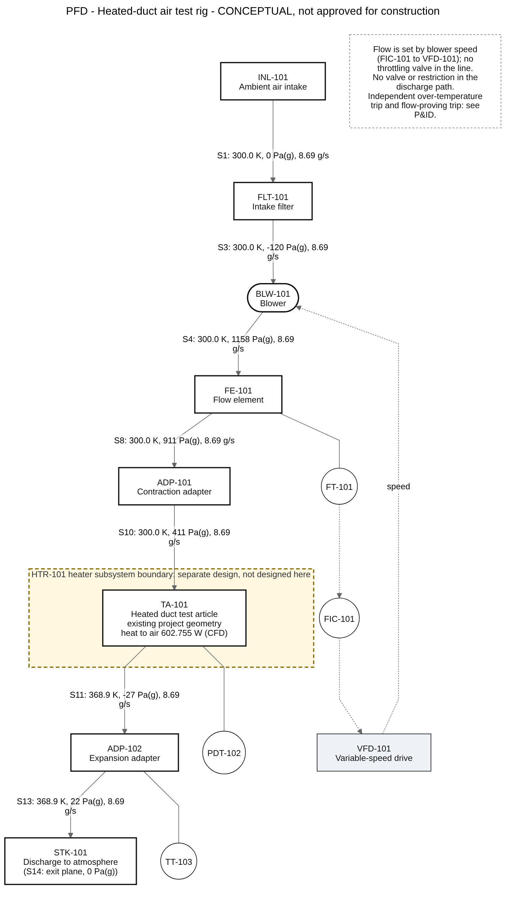
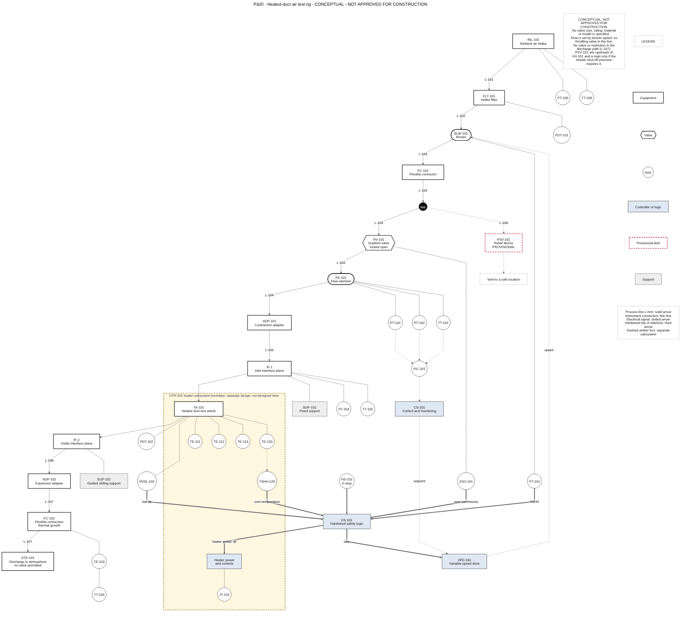

# 08 Fluid Test Rig Design

A conceptual air-supply, flow-control, instrumentation, heated-test-article and discharge system designed around the heated cylindrical duct that the rest of this repository analyses (20 mm bore, 40 mm outer diameter, 600 mm long, Inconel 718, 23.5 m/s of air at 300 K, 8000 W/m2 on the outer wall).

**Status.** This is a separate follow-on engineering exercise. It was written after the February to May 2025 internship period, after the LS-DYNA study and after the SQL extension, and it is not part of the internship. It runs no solver and adds no new simulation result: it uses the existing CFD and Mechanical results as inputs. It is a **conceptual, educational design, not approved for construction**, not a certified pressure-system design, and not a rocket-propulsion or launch-pad ground system. No commercial component, model number, rating, price or availability is given, and no standard compliance is claimed.

**Authorship and review.** Drafted with AI assistance (Claude Code) for the repository owner. No qualified piping, pressure-system, electrical, instrumentation or facility engineer has reviewed it. Items that need that review are listed in `LIMITATIONS_AND_NEXT_STEPS.md`.

## What it does

It takes the existing duct as the test article and builds a defensible preliminary design around it: the flow and pressure budget of the whole line (the tube's own CFD drop counted once and not mistaken for the system loss), a comparison of four line bores, a blower duty specification, generic component requirements with reasons, a PFD and P&ID with matching schedules, operating states, a preliminary hazard review, and checks that the whole set is consistent and reproducible.





## Headline results

| Quantity | Value | Basis |
| --- | --- | --- |
| Mass flow, from the existing CFD inlet condition | 8.69 g/s (7.38 L/s at 300 K, 101,325 Pa) | CALC from M002, M003, M005, M023 |
| Reynolds number at the inlet (reproduces the CFD) | 29,958 | CALC; CFD 29,958 (M034) |
| Test-article loss in the budget | 363.48 Pa total-pressure loss, from the CFD static drop of 438.13 Pa | CFD (M036), converted once |
| Recommended line bore | 50 mm (velocity 3.8 m/s) | Lowest nominal fan pressure of the candidates that pass screening |
| Fan total pressure at the design point | 1,278 Pa nominal, 669 to 1,857 Pa across the loss corners | CALC with ASSUMED generic rows |
| Blower specification for vendors | at least 9.41 L/s at a fan total pressure of at least 2,722 Pa at full speed | REQ-PRES-01; not a selection |
| Share of the nominal budget on generic or vendor-dependent data | 37 % | Vendor data required |
| Free axial growth of the test article | 1.84 mm (up to 2.07 mm in the studied cases) | EXISTING (M085, M155) |
| Force if both ends were rigidly restrained (bound only) | 548,936.6 N | EXISTING (M091) |

Everything above is conceptual. The pressure budget is a defensible preliminary estimate, not a blower selection: roughly a third of it rests on generic coefficients and allocations that vendor data will replace.

## Files

| File | Content |
| --- | --- |
| README.md | This file |
| DESIGN_BASIS.md | Verified inputs, source-to-requirement table, derived flow quantities, assumptions register, standards-for-limits references |
| SYSTEM_DESCRIPTION.md | Arrangement, selection rationale, tags, operating states, heater boundary, thermal and structural interfaces |
| CALCULATION_METHOD.md | Equations, pressure bookkeeping, budget, candidate bores, sensitivity, blower duty, interface screening |
| calculations.py | The calculation script (standard library only, deterministic) |
| validate_design.py | The validation script; writes `VALIDATION_REPORT.md` |
| pressure_drop_budget.csv | Row-by-row budget for each candidate bore (low, nominal, high) |
| candidate_line_sizes.csv | Comparison of the 25, 40, 50 and 80 mm bores |
| pressure_budget_sensitivity.csv, stream_table.csv, system_curve.csv, flow_basis.csv, thermal_structural_interface.csv, calculation_results.json | Further outputs of `calculations.py` |
| line_list.csv, equipment_schedule.csv, instrument_index.csv | Schedules; every tag in the diagrams is here |
| PFD.mmd, PFD.svg, PFD.png | Process flow diagram: Mermaid source and renders |
| PID.mmd, PID.svg, PID.png | Piping and instrumentation diagram: Mermaid source and renders |
| mermaid-config.json | Renderer settings used for the exports |
| PRELIMINARY_HAZARD_REVIEW.md | Hazards, safeguards, verified standards list, review items |
| REQUIREMENTS_TRACEABILITY.csv | 34 requirements with source, implementation, verification and status |
| VALIDATION_REPORT.md | Result of every check (generated) |
| LIMITATIONS_AND_NEXT_STEPS.md | Limitations, open questions, items for a qualified engineer, next steps |

## How to run

Written for Python 3.9 or later (the syntax was checked for 3.9, but no 3.9 interpreter was available); tested with 3.11, 3.12 and 3.13, which give byte-identical outputs. Standard library only; nothing to install.

```
cd 08_Fluid_Test_Rig_Design
python calculations.py                 # regenerate the CSV and JSON outputs
python validate_design.py              # run the checks; rewrites VALIDATION_REPORT.md; exit 1 on a failure
python calculations.py --outdir DIR    # write somewhere else, e.g. a temporary directory
```

`calculations.py` refuses to write inside the repository outside this folder. `validate_design.py` reruns the calculation in a clean temporary directory and requires byte-identical output. The checks cover flow continuity and an independent reproduction of the 7.38 L/s estimate, the pressure-budget arithmetic, tag consistency, diagram-to-schedule consistency (both directions), traceability of every sourced value to the master data register, identification of assumptions, and detection of rows that rely on generic or vendor-dependent data. The result is in `VALIDATION_REPORT.md`.

The diagrams are Mermaid source files. The exports in this folder were rendered with `@mermaid-js/mermaid-cli` 11.4.2:

```
mmdc -c mermaid-config.json -i PID.mmd -o PID.svg -b white
mmdc -c mermaid-config.json -i PID.mmd -o PID.png -b white -s 2
```

GitHub also renders Mermaid fenced blocks in Markdown, but the `.mmd` files are kept as the editable source.

## Read this with

- `REPOSITORY_STRUCTURE.md`, `NOTICE.md` and `GITHUB_CONTENT_AUDIT.md` at the repository root: the repository's own publication and licensing caveats still apply, and this folder is **not yet recorded** in the structure and audit files or in `MANIFEST.csv`, which were deliberately left unchanged.
- The existing sources it relies on: `01_Project_Documentation/BASELINE_PARAMETERS.md`, `02_CFD_Fluent/Baseline/CFD_BASELINE_RESULTS.md`, `03_Thermal_Structural_Mechanical/Case_Matrix/PARAMETRIC_CASE_MATRIX.csv` and `05_Data/MASTER_PROJECT_DATA.csv`.
