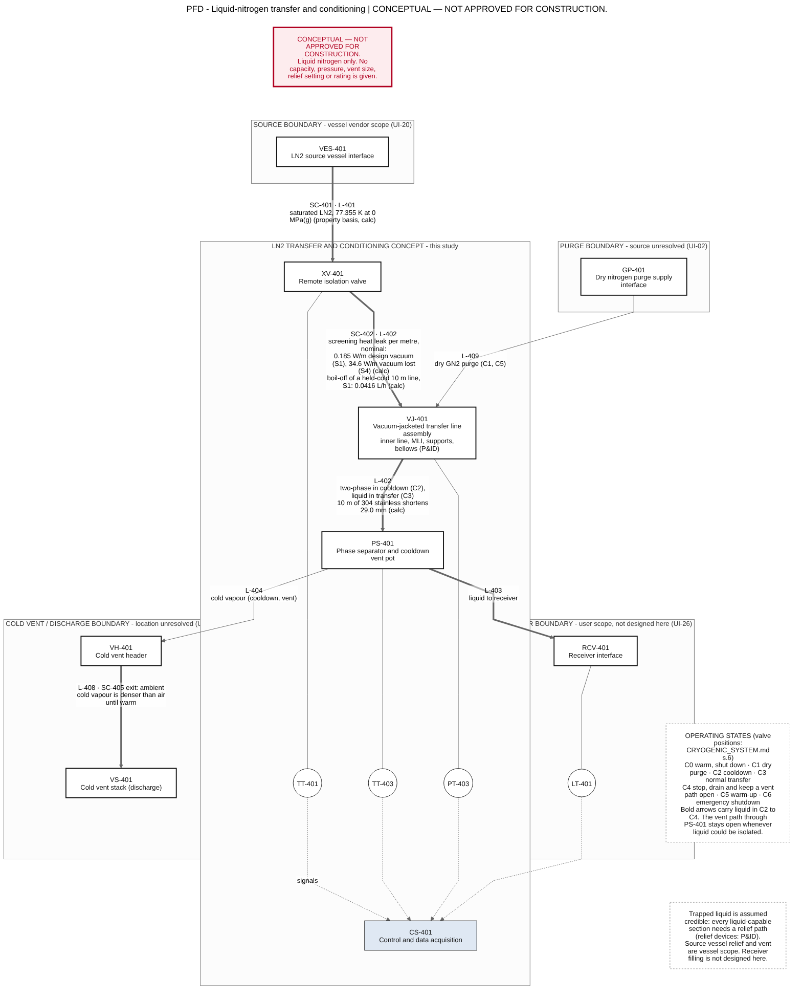
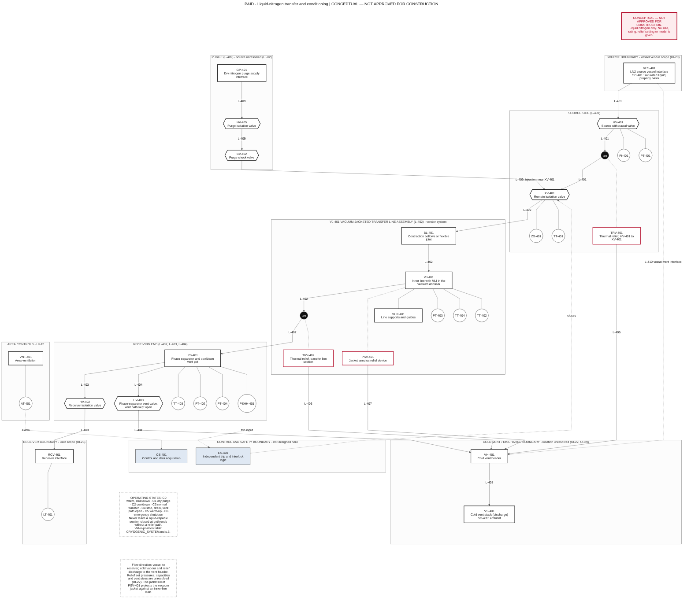

# Liquid-nitrogen transfer and conditioning system

**Status: conceptual and educational. CONCEPTUAL — NOT APPROVED FOR CONSTRUCTION.** Liquid nitrogen only: no liquid oxygen, liquid hydrogen, propellant, combustion or hazardous operating trial is considered. No vessel capacity, allowable pressure, vent size, relief setting or component rating is established. Everything marked IL-nn is an illustrative study case and everything marked UI-nn is an unresolved input (`DESIGN_BASIS.md`).

## 1. Purpose and scope

A functional concept for moving liquid nitrogen from a source vessel (UI-20) to a receiver (UI-26) through an insulated transfer line, and for conditioning that line (purge, cooldown, warm-up). It covers the source interface, a vacuum-jacketed line concept, isolation and controlled transfer, thermal contraction and supports, heat leak and boil-off, trapped-liquid expansion, relief and venting philosophy, measurement, material compatibility, and the operating states (warm shutdown, purge, cooldown, normal transfer, stop and drain, warm-up, emergency).

**Classification, governing design code and jurisdiction are items for review (UI-05)**, not choices made here. NASA-STD-5005D 5.2.2 (read) names ASME Section VIII and B31.3 (for Severe Cyclic Conditions) for cryogenic servicing of NASA ground support equipment, and it applies to NASA space flight programs at their discretion; ASME B31.3 text was not read (`DESIGN_BASIS.md` section 7). No compliance is claimed.

**The existing rig is not affected.** `08_Fluid_Test_Rig_Design/` remains a low-pressure air system.

## 2. Functional architecture

Tags are in `equipment_schedule.csv` and `instrument_index.csv`; lines are in `line_list_cryogenic.csv`.

| Function | Tags | Concept and reason |
|---|---|---|
| Source-vessel interface | VES-401, HV-401, PI-401, PT-401, L-401, L-410 | Boundary item. Vessel capacity, pressure, withdrawal and relief are vessel scope (UI-20). Only the connection of the vessel vent to VH-401 is shown |
| Insulated transfer line | VJ-401, L-402, BL-401, SUP-401 | A vacuum-jacketed inner line with multilayer insulation is the baseline concept because it gives a much lower heat leak than the bare-surface case (S1 against S2 in `cryogenic_heat_leak.csv`); other insulation concepts, for example foam, were not evaluated. The vendor system and its data are UI-23 |
| Isolation and controlled transfer | HV-401, XV-401, HV-402, ES-401, PSHH-401, ZS-401 | XV-401 starts and stops the transfer remotely and closes on an independent trip. HV-401 and HV-402 are manual isolation at the two ends |
| Thermal contraction and support movement | BL-401, SUP-401 | The inner line shortens on cooldown relative to the warm jacket. Anchors must not restrain the line axially unless a movement device is designed in (section 4) |
| Heat leak and boil-off | VJ-401, PT-403, TT-404 | Screening model in section 3. PT-403 detects loss of vacuum and TT-404 detects a cold spot on the jacket skin |
| Trapped-liquid expansion | TRV-401, TRV-402, HV-403, PSV-401 | Trapped liquid is assumed to occur. Every liquid-capable section has a relief path to a safe location (section 5) |
| Relief and venting | TRV-401, TRV-402, PSV-401, PS-401, HV-403, VH-401, VS-401, L-404 to L-408 | Relief and cold vapour discharge to a cold vent header and a stack at a safe location. Sizes, set pressures and location are UI-22, UI-29 |
| Phase separation for cooldown | PS-401 | Takes the two-phase flow of the cooldown, sends vapour to the vent and liquid to the receiver once the flow is single-phase |
| Dry purge | GP-401, HV-405, CV-402, L-409 | Dry nitrogen removes moisture and air before cooldown and speeds warm-up. CV-402 is justified: liquid must not back up into the purge line |
| Measurement | TT-401, TT-402, TT-403, PT-401, PT-402, PT-403, PT-404, TT-404, LT-401 | Temperatures follow the cooldown front and detect liquid arrival; pressures watch trapped sections and the vent; vacuum and skin temperature watch the insulation; level watches the receiver. Cryogenic qualification of each sensor is UI-31 |
| Ventilation and oxygen deficiency | VNT-401, AT-401 | Room volume and ventilation rate are UI-12 |

## 3. Heat leak and boil-off

**Model** (`CALCULATION_METHOD.md` section 5; `cryogenic_heat_leak.csv`). Heat leak per metre of line is the sum of radiation across the vacuum annulus, residual-gas conduction in the annulus and conduction through supports. The boundary temperatures are the boiling temperature of nitrogen, <!--h:T_sat_K-->77.355<!--/h--> K at 0.101325 MPa (VERIFIED), and 300 K (M002); the geometry is illustrative (IL-12 to IL-14); the emissivities, accommodation, vacuum levels and support paths are ASSUMED placeholders (AS-10 to AS-14). Boil-off is the heat load divided by the latent heat of vaporization of <!--h:hfg-->199.18<!--/h--> kJ/kg (VERIFIED, from the equation-of-state table).

**Results, nominal case, per metre of line** (these are screening values for the placeholders, not predictions for a real line):

| Scenario | Heat leak (W/m) | Remark |
|---|---:|---|
| S1 vacuum-jacketed line with MLI, design vacuum | <!--h:Q_S1_nom-->0.185<!--/h--> (low <!--h:Q_S1_low-->0.0678<!--/h-->, high <!--h:Q_S1_high-->0.994<!--/h-->) | Boil-off of <!--h:boil_S1_g_s_m-->0.000931<!--/h--> g/s per metre, <!--h:boil_S1_L_h_10m-->0.0416<!--/h--> L/h for a held-cold 10 m line |
| S2 same without MLI (bare surfaces) | <!--h:Q_S2_nom-->2.55<!--/h--> | Radiation dominates |
| S3 with MLI, degraded vacuum (1 Pa) | <!--h:Q_S3_nom-->14.2<!--/h--> | Transitional gas regime, bridged: low confidence |
| S4 with MLI, vacuum lost (annulus at ambient pressure) | <!--h:Q_S4_nom-->34.6<!--/h--> | Conduction only, so a **lower bound**: the Rayleigh number of the annulus gap is <!--h:Ra_S4-->3.64e+05<!--/h-->, so convection would add more. <!--h:boil_S4_L_h_10m-->7.77<!--/h--> L/h for 10 m |

Losing the vacuum raises the heat leak by a factor of about <!--h:ratio_S4_S1-->187<!--/h--> in this model. The wide spread is the point: the vacuum level and the insulation performance matter more than any other single item. The uncertainty is dominated by the MLI emissivity (a swing of <!--h:unc_mli_pct-->174<!--/h--> percent of the S1 nominal across its range) and by the support conduction path (a swing of <!--h:unc_AL_pct-->131<!--/h--> percent); see `cryogenic_uncertainty.csv`. Heat leak of terminations, valves, flanges and bayonet joints is **not included** (AS-17), and the **normal evaporation rate of the source vessel is not calculated**: it needs the vessel data (UI-20). These rows are in the CSV as NOT CALCULATED.

**Cooldown** (`cryogenic_cooldown.csv`, line metal only, AS-21). Cooling 1 m of the illustrative inner line from 300 K takes about <!--h:cool_LN2_kg_m-->0.50<!--/h--> kg of liquid nitrogen if only the latent heat is used. For 10 m the figure is <!--h:cool_LN2_L_10m_lat-->6.2<!--/h--> L, falling to <!--h:cool_LN2_L_10m_full-->2.9<!--/h--> L if the vapour leaves at 300 K. Valves, flanges, supports and the receiver add to this and can dominate (UI-28).

## 4. Thermal contraction and support movement

Source: NIST curve fits for the linear expansion of 304 stainless steel and 6061-T6 aluminium (VERIFIED, fit errors 5 and 4 percent); `thermal_contraction.csv`.

- 304 stainless steel shortens by <!--h:ss_strain_pct-->0.290<!--/h--> percent between 300 K and 77.355 K: <!--h:ss_dL_10m_mm-->29.0<!--/h--> mm over an illustrative 10 m run. 6061-T6 aluminium shortens by <!--h:al_dL_10m_mm-->40.4<!--/h--> mm over the same run.
- If the illustrative inner line were **fully restrained**, the thermal stress bound for 304 stainless steel is about <!--h:ss_stress_MPa-->580<!--/h--> MPa, a force of about <!--h:ss_force_kN-->84<!--/h--> kN on the illustrative section. This is a **bound**, not a prediction, and **no allowable stress is compared with it** because none is available (UI-25). It is large enough that restraint must be designed out or absorbed by a movement device (BL-401, loops) and by sliding supports (SUP-401).
- The warm jacket does not shorten, so the inner line moves relative to the jacket by the same amount; the movement capacity of the bellows or loops is vendor data (UI-24).
- The supports are also the main solid heat-leak path (section 3).

## 5. Trapped liquid, relief and venting philosophy

**Do not assume a cryogenic line can be isolated safely when liquid may be trapped.** Liquid nitrogen in a closed volume that warms cannot expand. From the verified isochore, liquid-full at the 1 atm saturated density, the pressure rises by about <!--h:dpdT_trap-->1.73<!--/h--> MPa per kelvin (`trapped_liquid.csv`). With the placeholder heat leak and no relief, a liquid-full metre of bore reaches 1 MPa(g) in about <!--h:trap_t_S1_1MPa_min-->16<!--/h--> minutes (S1 nominal) and 5 MPa(g) in about <!--h:trap_t_S1_5MPa_min-->78<!--/h--> minutes; with bare surfaces (S2) it reaches 1 MPa(g) in about <!--h:trap_t_S2_1MPa_min-->1<!--/h--> minute; with the vacuum lost (S4) in about <!--h:trap_t_S4_1MPa_s-->5<!--/h--> seconds. These thresholds are screening levels, **not allowable pressures or relief settings**, and the times ignore the thermal mass of the metal, so they are the shortest. A partly filled closed volume behaves differently: at 760 kg/m3 the volume does not become liquid-full until about <!--h:Tfull_760_K-->87.4<!--/h--> K, and at 700 kg/m3 about <!--h:Tfull_700_K-->99.9<!--/h--> K (first tabulated single-phase temperatures), but then the pressure rises as steeply.

**Philosophy.**

1. Every section that can hold liquid between two closed valves has its own relief path to a safe location: TRV-401 (HV-401 to XV-401), TRV-402 (the transfer line), and valve bonnets and instrument lines to be handled by the valve design.
2. A vent path stays open whenever liquid could otherwise be isolated: HV-403 stays open in the warm, purge, cooldown, stop and warm-up states, and the stop and emergency procedures never close the receiving-end valves on a liquid-filled line without that path.
3. The vacuum jacket is protected by PSV-401 against an inner-line leak into the annulus.
4. A trip (PSHH-401, ES-401, XV-401) is not a relief device.
5. Relief and vent discharge are cold, possibly liquid, and denser than air until warm: they go to a header and stack at a location chosen for dispersion (UI-29). Relief devices must be suitable for the cold fluid and must not freeze shut.
6. Relief set pressures, capacities, vent sizes and the sizing method (boil-off, trapped liquid, jacket failure) are **UI-22 and are not given**.

## 6. Operating states and valve positions

O open, C closed, T throttled. Failure positions on loss of power or air are **UI-13** and are not assumed. CV-402 acts passively.

| State | HV-401 | XV-401 | HV-403 | HV-402 | HV-405 | Purpose and notes |
|---|---|---|---|---|---|---|
| C0 warm, shut down | C | C | O | C | C | Vent path open. Line warm and dry |
| C1 dry purge | C | O | O | C | O | Dry nitrogen through the line to the cold vent: removes moisture and air before cooldown |
| C2 cooldown | O (slowly) | O (metered) | O | C | C | Low-flow chilldown with two-phase flow to PS-401 and the vent. End point: liquid at TT-403 and the wall near saturation at TT-402. Two-phase surges and valve actions are UI-33 |
| C3 normal transfer | O | O | T or O | O | C | Liquid to the receiver. HV-403 setting (open, throttled, pressure controlled) is open (UI-22, UI-29) |
| C4 stop, drain, vent path open | C | O | O | C | C | Stop the supply, let the line empty or boil off through the vent. Do not close XV-401 until the line is vapour only |
| C5 warm-up | C | O | O | C | O | Dry nitrogen purge while the line warms. End point: wall temperature near ambient at TT-402 and TT-403 |
| C6 emergency shutdown | C (manual) | closed by ES-401 | O | C | C | Liquid may be trapped between HV-401 and XV-401, protected by TRV-401. The transfer line stays vented through PS-401 |

## 7. Materials and compatibility

Material grades, impact-toughness requirements and allowable stresses are **UI-25**. In general terms, materials must keep toughness at 77 K (many ferritic carbon steels and many polymers and elastomers do not), seals and valve packings must work at the service temperature, and surfaces below about 90 K can condense oxygen from air (the boiling temperature at 1 atm is <!--h:T_sat_K-->77.355<!--/h--> K for nitrogen and <!--h:T_boil_O2_K-->90.188<!--/h--> K for oxygen, VC-06), which gives oxygen-enriched liquid that is a fire hazard near organic material. Cold surfaces are therefore insulated and kept away from combustible material and drains. Cleaning level and the compatibility of lubricants and seals are UI-10. Only the thermal properties of 304 stainless steel and 6061-T6 aluminium were used, and only for the screening calculations.

## 8. Two-phase flow

Cooldown is a two-phase process. The saturated liquid is <!--h:ratio_sat_1atm-->175<!--/h--> times denser than its vapour at 0.101325 MPa and about <!--h:odh_ratio_ln2-->708<!--/h--> times denser than nitrogen gas at 300 K, so a little boiling produces a large vapour volume and the line can vapour-lock, surge and flash (`cryogenic_property_screening.csv`). Closing a valve on a flowing liquid line can also produce a pressure surge. Two-phase pressure drop, flow regime, vent loads and hydraulic transients are **not calculated**: they need the line geometry and the transfer rate (UI-21, UI-27, UI-33).

## 9. Unresolved items

Source vessel (UI-20), line length, route and bore (UI-21), allowable pressures, relief and vent sizes (UI-22), insulation data (UI-23, UI-32), supports and movement (UI-24), materials (UI-25), receiver (UI-26), transfer rate (UI-27), cooldown limits and thermal masses (UI-28), cold vent and dispersion (UI-29), environment (UI-30), instrument qualification (UI-31), two-phase data (UI-33), failure positions (UI-13) and classification and code (UI-05). The preliminary hazard review is in `HAZARD_REVIEW_CRYOGENIC.md`.
