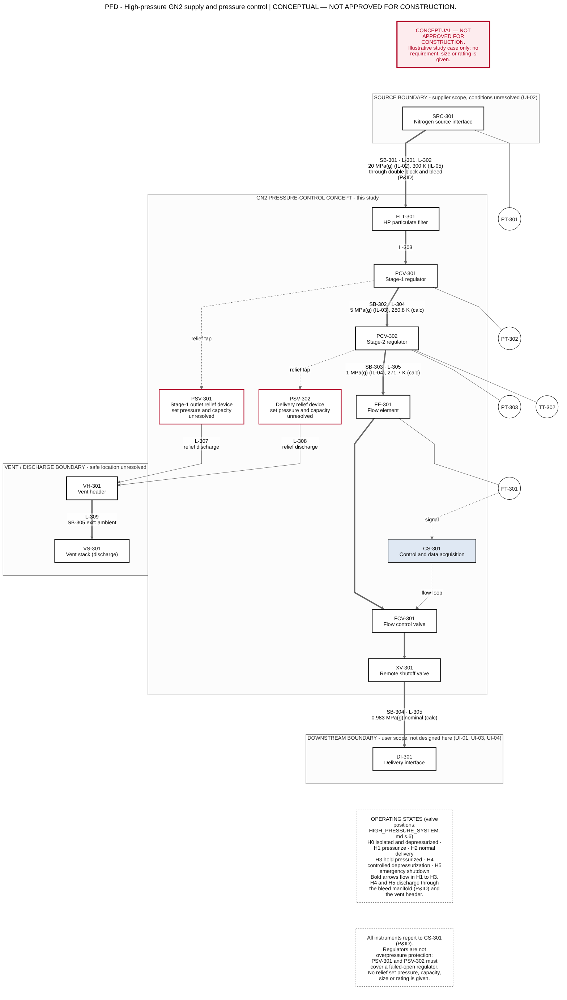
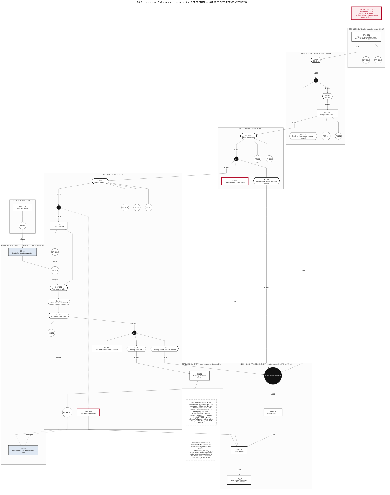

# High-pressure gaseous-nitrogen supply and pressure-control system

**Status: conceptual and educational. CONCEPTUAL — NOT APPROVED FOR CONSTRUCTION.** No operating pressure, source condition, flow, relief setting, size or rating is established here. Pressures and flows marked IL-nn are illustrative study cases. Everything marked UI-nn is an unresolved input. See `DESIGN_BASIS.md` for the classes and the registers, and `LIMITATIONS_AND_NEXT_STEPS.md` for what this study cannot tell you.

## 1. Purpose and scope

A functional concept for taking gaseous nitrogen from a source of unresolved pressure (UI-02), reducing and controlling its pressure and flow, and delivering it to a downstream user whose requirements are unresolved (UI-01, UI-03, UI-04). It covers the source interface, staged regulation, isolation and controlled depressurization, monitoring, flow control and measurement, a conditional check valve, overpressure protection, vent routing, ventilation and oxygen-deficiency controls, and test and maintenance interfaces. It does not select a component, set a rating, or size any relief device.

**Pressure-system classification and governing design code are items for review (UI-05), not choices made here.** NASA-STD-8719.17D and NASA-STD-5005D (both read in part, section 7 of `DESIGN_BASIS.md`) are cited only as reference practice. ASME B31.3 is listed for review; its text was not read. For scale only: the 8719.17D exclusion for inert-gas piping covers MAWP up to 150 psig and NPS 2 and does not cover higher-pressure systems that supply them, and the Category D scope of B31.3 that suited the 08 air rig is limited to 1035 kPa gauge. The illustrative source pressure is far above both.

## 2. Functional architecture

Tags are in `equipment_schedule.csv` and `instrument_index.csv`; lines are in `line_list_high_pressure.csv`.

| Function | Tags | Concept and reason |
|---|---|---|
| Nitrogen source interface | SRC-301, PT-301, TT-301, PI-301 | Boundary item owned by the supplier. Source pressure, temperature and depletion are UI-02, so the concept is shown against an illustrative source (IL-02) |
| Isolation | HV-301, HV-302 with bleed HV-303 | Two blocks in series with a vent between them, so that the source can be isolated and the isolation proved. NASA-STD-5005D 5.2.6(b) is a precedent for the same arrangement in a specific application |
| Controlled depressurization | HV-303, HV-306, HV-305, RO-301, L-306, VH-301 | Each zone that can trap gas has a bleed. All bleeds share a restrictor so that vent flow, noise and cold are limited. The intermediate zone between two regulators cannot drain through either regulator, so it needs its own bleed (HV-306) |
| Filtration | FLT-301, PDT-301 | Protects regulator seats and the downstream user from particles |
| Pressure regulation, stages | PCV-301, PCV-302 | Two stages limit the pressure ratio and cooling per stage and reduce the effect of source depletion on the delivery pressure. The stage count is a concept rationale to be confirmed with vendor data (UI-08) |
| Pressure and temperature monitoring | PT-301, PT-302, PT-303, TT-301, TT-302, PI-301, PI-302, PI-303, PDT-301 | Transmitters report to CS-301. Local gauges allow verification and calibration before work. TT-302 watches the cold gas after stage 2 |
| Downstream flow control and measurement | FE-301, FT-301, FIC-301, FCV-301 | A flow loop acts on FCV-301. The valve drop depends on the unresolved downstream limits, so it is an unresolved row of the budget |
| Check valve, where justified | CV-301 (conditional) | See section 5. Shown dashed |
| Overpressure protection | PSV-301, PSV-302; independent trip PSHH-301, ES-301, XV-301 | Relief devices must cover a failed-open regulator. A regulator is not overpressure protection and a trip does not replace a relief device. No set pressure or capacity is given |
| Vent and discharge routing | L-306 to L-309, VH-301, VS-301 | Relief and bleed discharge to one header and a stack at a safe location (UI-11) |
| Ventilation and oxygen-deficiency controls | VNT-301, AT-301 | Room volume and ventilation rate are unresolved (UI-12). The alarm basis is the 19.5 percent threshold (VC-05) |
| Test and maintenance interfaces | TP-301, PI-301, PI-302, PI-303, HV-303, HV-305, HV-306 | Leak check, calibration and proof of isolation without opening the process line |

## 3. Boundary conditions and the illustrative case

The register is `boundary_conditions.csv`. The illustrative case is **IL-02 = 20 MPa(g) source, IL-03 = 5 MPa(g) intermediate, IL-04 = 1 MPa(g) delivery, 300 K at the source**, with an illustrative flow of <!--h:mdot_g_s-->8.686<!--/h--> g/s (<!--h:Qstd_L_s-->7.63<!--/h--> L/s as gas at 300 K and 0.101325 MPa; IL-01, the heated-duct air design flow reused only for its magnitude). Design pressures, relief settings and the real downstream limits are UNRESOLVED and have no value.

## 4. Calculation results (screening, illustrative case)

All values are CALCULATED from VERIFIED nitrogen properties and the ASSUMED and ILLUSTRATIVE inputs of `DESIGN_BASIS.md` section 5. They do not validate integrity, relief sizing or code compliance. Method: `CALCULATION_METHOD.md`.

**Gas state.** At the illustrative source condition the compressibility factor is <!--h:Z_source-->1.058<!--/h-->, so an ideal-gas calculation there would be off by about 6 percent.

**Cooling across the regulators** (isenthalpic expansion, no heat gain; `regulator_envelope.csv`):

- stage 1 (20 to 5 MPa(g)): <!--h:dT_stage1-->-19.2<!--/h--> K, leaving at <!--h:T_out_stage1-->280.8<!--/h--> K;
- stage 2 (5 to 1 MPa(g)): <!--h:dT_stage2-->-9.1<!--/h--> K, leaving at <!--h:T_out_stage2-->271.7<!--/h--> K;
- a single stage from the source to the delivery pressure would cool the gas by <!--h:dT_single-->-28.3<!--/h--> K.

The gas leaves the regulators below 273 K, so external icing and cold-material limits matter (UI-10), and TT-302 is on the delivery side.

**Regulator capacity envelope.** Stage 1 is choked over most of the swept inlet range (outlet to inlet absolute pressure ratio <!--h:ratio_stage1-->0.254<!--/h--> at the illustrative source). One square millimetre of unobstructed flow area would pass about <!--h:flux_source-->35.9<!--/h--> g/s at the illustrative source pressure, which is <!--h:flux_multiple_source-->4.1<!--/h--> times the illustrative flow, and the same flux enters stage 2 if stage 1 fails open (<!--h:flux_stage2_fail-->35.9<!--/h--> g/s per mm2). These are scale figures for the loss-of-regulation hazard, **not a relief-sizing calculation**: the real seat area, discharge coefficient and real-gas behaviour are vendor data (UI-08, UI-07). The effective flow area needed at stage 1 for the illustrative flow is <!--h:Areq_stage1-->0.242<!--/h--> mm2 at the illustrative source pressure and grows by a factor of <!--h:Areq_growth-->4.2<!--/h--> to <!--h:Areq_stage1_6MPa-->1.02<!--/h--> mm2 when the source has depleted to 6 MPa(g): regulator capacity falls as the inlet pressure falls, so the lower end of the source range must be part of the specification.

**Pressure budget** (`pressure_budget.csv`, `pressure_sensitivity.csv`; uniform illustrative bore IL-06, route AS-05). The nominal passive loss downstream of stage 2 is <!--h:dp_del_nom_kPa-->16.64<!--/h--> kPa, <!--h:dp_del_pct-->1.66<!--/h--> percent of the delivery set pressure, with <!--h:dp_del_high_kPa-->36.30<!--/h--> kPa in the high case; the nominal pressure at the delivery interface is <!--h:p_DI_MPa_g-->0.983<!--/h--> MPa(g). The loss in the high-pressure zone is <!--h:dp_hp_nom_kPa-->50.8<!--/h--> kPa and is almost entirely the filter allocation. <!--h:vendor_share_del_pct-->44<!--/h--> percent of the delivery-zone loss rests on generic loss coefficients or allocations that need vendor data, and the remainder is pipe friction on an assumed route, so **no row of the budget is supported by component data**. Three rows are carried as unresolved, not as numbers: the flow-control valve drop (UI-04), the check-valve cracking pressure (UI-09) and the relief and vent back-pressure (UI-07, UI-11). The budget is compared with an illustrative limit (IL-09) only to show how the method works.

**Sensitivity.** Over bores of 6 to 20 mm and component-loss multipliers of 0.5 to 4 the delivery loss moves from about 0.3 percent to <!--h:sens_worst_pct-->23.84<!--/h--> percent of the set pressure (the worst case is the 6 mm bore with all component losses four times nominal, with a peak velocity of <!--h:sens_worst_v-->30.6<!--/h--> m/s). The smallest swept bore (6 mm) exceeds the illustrative limit in every case, and the next size up (8 mm) does so once component losses are doubled or more. At these illustrative flows the line diameter is therefore set by velocity, noise and erosion screening and by the downstream limits (UI-04), and not by the pressure budget in the large-bore range.

## 5. Overpressure protection, check valve, vent and oxygen deficiency

**Overpressure protection philosophy.** Every zone downstream of a regulator is either designed for the pressure of the zone upstream or protected by a relief device that passes the flow of the failed-open regulator (the practice stated in NASA-STD-8719.17D 4.10.3.2, read; no compliance is claimed). PSV-301 protects the intermediate zone and PSV-302 protects the delivery zone, including the case where stage 1 has also failed open and the stage-2 inlet sees the full source pressure. The independent trip (PSHH-301 to ES-301 to XV-301) limits exposure and duration but is not a relief device. Required capacities, set pressures and discharge locations are UI-07.

**Check valve (CV-301), conditional.** A check valve is justified only if backflow from the downstream user into the pressure-control section is a credible hazard, for example when the downstream side can be pressurized or contaminated while supply is lost. It is not an isolation device (it leaks), it adds a loss (K in the budget) and a cracking pressure that is vendor data, and it can fail closed or stick. Whether it is needed is an open decision (HAZ-HP-09).

**Vent and discharge.** Relief and bleed discharge to a common header and a stack at a location that does not expose people, air intakes or equipment (UI-11). Relief back-pressure must be checked against the relief devices' limits once flows are known. Controlled depressurization goes through the bleed manifold and restrictor RO-301, not through the process path.

**Ventilation and oxygen deficiency.** Nitrogen is not toxic but displaces oxygen. The screening in `oxygen_deficiency_screening.csv` (well-mixed room, AS-20) shows that vaporizing about <!--h:odh_ln2_L_10m3-->1.01<!--/h--> L of liquid nitrogen into a well-mixed 10 m3 room is enough to bring it to 19.5 percent oxygen, and that releasing the gas contained in about <!--h:odh_gn2_L_10m3-->3.8<!--/h--> L of vessel volume at 20 MPa(g) does the same. Local concentrations near a release can be far lower than the room average. VNT-301 and AT-301 are the concept controls; their sizing and setpoints are UI-12.

## 6. Operating states and valve positions

O open, C closed, TBD to be decided. Failure positions of XV-301 and FCV-301 on loss of power or air are **UI-13** and are not assumed.

| State | HV-301 | HV-302 | HV-303 | HV-306 | HV-305 | HV-304 | XV-301 | FCV-301 | Purpose and notes |
|---|---|---|---|---|---|---|---|---|---|
| H0 isolated, depressurized | C (locked) | C | O | O | O | C | C | closed | Safe for work. Vent each zone first (H4), then close HV-302 |
| H1 pressurize | O (slowly) | O | C | C | C | C | C | closed | Fill the high-pressure zone with the delivery side isolated. Open slowly; sudden opening into a closed volume causes heating and shock (HAZ-HP-14) |
| H2 normal delivery | O | O | C | C | C | O | O | controlling | Flow under FIC-301. PT-302, PT-303 and TT-302 monitored |
| H3 hold pressurized | O | O | C | C | C | C | C | closed | No flow. Regulators lock up; check for creep into the closed zones |
| H4 controlled depressurization | C | O until the high-pressure zone is at ambient | O | O | O | C | C | closed | Vent in order: delivery zone (HV-305), intermediate zone (HV-306), high-pressure zone (HV-303 with HV-302 open), all through RO-301 |
| H5 emergency shutdown | C (manual) | O | C | C | C | no change | closed by ES-301 | closed | Relief devices stay active. Return to H3, then H4 by procedure |

## 7. Test and maintenance interfaces

TP-301 gives leak-check, pressure-test and gauge-calibration access to the delivery zone. PI-301, PI-302 and PI-303 allow local verification before bleeding or opening a zone. HV-303 proves block 1 when HV-302 is closed. Test pressures, test media and the acceptance criteria depend on the classification and code (UI-05) and are not stated.

## 8. Open decisions

Operating pressure and tolerance (UI-01), source (UI-02), flow (UI-03), downstream limits (UI-04), classification and code (UI-05), design pressures (UI-06), relief (UI-07), regulator data (UI-08), component specifications (UI-09), materials and seals for the cold gas (UI-10), vent routing (UI-11), ventilation and room volume (UI-12), failure positions (UI-13), and whether CV-301 is needed (HAZ-HP-09). The preliminary hazard review is in `HAZARD_REVIEW_HIGH_PRESSURE.md`.
